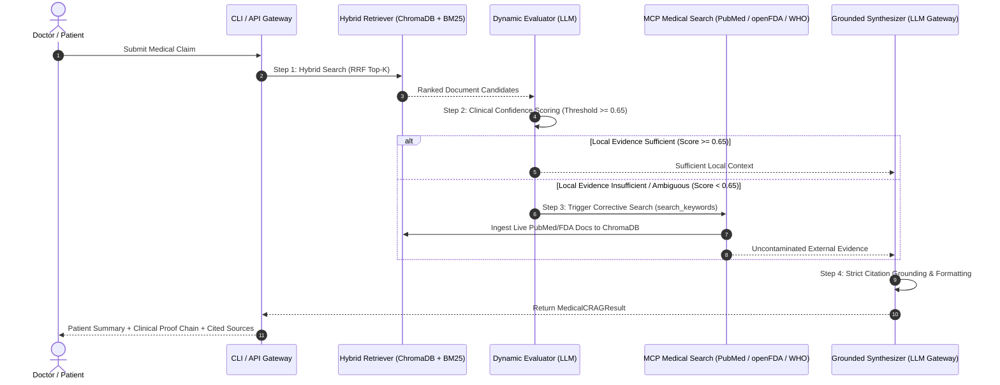

# 🏥 Medical Corrective RAG (CRAG)

> **High-Precision Biomedical Claim Verification System with Dynamic Corrective Search & Grounded Proof Chains**

[](https://www.python.org/downloads/)
[](https://www.trychroma.com/)
[](https://pubmed.ncbi.nlm.nih.gov/)
[](https://open.fda.gov/)
[](https://www.who.int/emergencies/disease-outbreak-news)
[]()

---

## 📌 Executive Summary

Standard Retrieval-Augmented Generation (RAG) fails in clinical healthcare because it operates on a closed, static corpus and blindly trusts retrieved documents—even when they are irrelevant, partial, or out-of-date. Conversely, complex GraphRAG and multi-agent swarms introduce excessive latency, non-deterministic loops, and fragile ontology schemas.

**Medical Corrective RAG (CRAG)** solves this by introducing an autonomous, high-speed, self-correcting 4-stage pipeline that:
1. **Performs Hybrid Retrieval** (BM25 Lexical + ChromaDB Cosine Embeddings via Reciprocal Rank Fusion).
2. **Dynamically Evaluates Retrieved Documents** for clinical relevance and confidence against the specific medical claim.
3. **Triggers External Medical Search** via authoritative MCP tools (**NCBI PubMed E-Utilities XML**, **openFDA Drug Labels**, **WHO Disease Outbreak News**) when local store knowledge is insufficient, auto-ingesting fresh evidence back into ChromaDB.
4. **Synthesizes Grounded Verifications** using a strict dual-layer output: a **Patient Summary** in plain language and an evidence-backed **Clinical Proof Chain** citing exact PubMed/openFDA links and quotations.

---

## 🏗️ ByteByteGo-Style System Architecture


### End-to-End Sequence & Decision Flow



---

## 🌟 Core Architectural Pillars

### 1. Hybrid Retrieval with Reciprocal Rank Fusion (RRF)
- **Dense Vector Search**: ChromaDB persistent vector database using cosine distance for semantic concept matching.
- **Lexical Keyword Search**: Pure-Python in-memory BM25 index with exact medical term matching, clinical tokenization, and stopword pruning.
- **RRF Scoring**: Combines ranks deterministically:
  $$\text{RRF Score}(d) = \sum_{m \in \{\text{dense}, \text{bm25}\}} \frac{1}{k + \text{rank}_m(d)} \quad (k = 60)$$

### 2. Dynamic Evaluator & Adaptive Corrective Routing
- Single LLM call evaluates retrieved candidates against the health claim.
- Outputs structured evaluation:
  - `status`: `CORRECT` (evidence directly supports/refutes claim), `INCORRECT` (evidence contradicts claim context), or `AMBIGUOUS` (insufficient/tangential evidence).
  - `confidence`: Float $[0.0, 1.0]$.
  - `search_keywords`: Dynamic medical search query generated only when evidence is insufficient, removing non-clinical stopwords.
- **Gating**: If `status == CORRECT` and `confidence >= 0.65`, pipeline bypasses external search, running in $< 3\text{s}$. If confidence $< 0.65$, external search is triggered immediately.

### 3. Authoritative MCP Medical Search & Auto-Ingestion
- **NCBI PubMed E-Utilities**: Queries `esearch` with clinical terms, fetches full XML abstracts via `efetch`, extracting structured sections (`BACKGROUND`, `METHODS`, `RESULTS`, `CONCLUSIONS`).
- **openFDA Drug Labels**: Searches FDA structured product labels (SPL) for adverse reactions, boxed warnings, and drug interactions.
- **WHO Disease Outbreak News**: Live monitoring for emergent infectious disease alerts.
- **Deterministic Auto-Ingestion**: Fresh documents are hashed via SHA-256 for stable IDs and upserted into ChromaDB with in-batch deduplication, continuously improving the local store.
- **Uncontaminated Evidence Flow**: When corrective search succeeds, irrelevant starter documents are discarded so the synthesizer only receives the authoritative retrieved evidence.

### 4. Multi-Provider LLM Gateway with Instant Failover
- **OpenRouter Primary**: Powered by `meta-llama/llama-3.3-70b-instruct` with JSON schema output and custom routing headers.
- **Google Gemini Fallback**: Native REST client for `gemini-1.5-flash` with zero third-party SDK lock-in.
- **Zero-Failure JSON Parsing**: Custom balanced-bracket string scanner extracts JSON objects from raw model responses even in the presence of conversational preambles or LaTeX math delimiters (`\{x = y\}`).
- **Strict Budget Gate**: Maximum 1 to 2 LLM calls per claim verification (1 Evaluator + 1 Synthesizer if needed).

### 5. Grounded Dual-Layer Verification
- **Patient Summary**: Jargon-free, compassionate, plain-language assessment suitable for patients and health consumers.
- **Clinical Proof Chain**: Rigorous biomedical explanation citing specific clinical trial outcomes, hazard ratios, and p-values.
- **Strict Source Grounding**: Synthesizer brackets (e.g. `[1]`, `[1, 2]`) are validated against the actual documents supplied, resolving to clickable PubMed URLs and direct excerpts.

---

## 📊 Live Verification Output Examples

### Example 1: Local Knowledge Base Sufficient
```bash
$ python -m medical_crag "Turmeric reduces inflammation in arthritis"
```
```
🔍 Processing claim through Corrective RAG: 'Turmeric reduces inflammation in arthritis'...

=================================================================
🏥 MEDICAL CORRECTIVE RAG VERIFICATION
=================================================================
Claim: "Turmeric reduces inflammation in arthritis"
Verdict: ✅ SUPPORTED (Confidence: 80%)
Execution Time: 2640 ms | Provider: openrouter
Corrective Action: Not Needed (Local Store Sufficient)
-----------------------------------------------------------------
📋 PATIENT SUMMARY (Plain Language):
  Turmeric has been shown to reduce inflammation in arthritis, particularly 
  in knee osteoarthritis, by significantly reducing pain. This natural remedy 
  may be a helpful addition to traditional treatments. However, it's essential 
  to consult with a healthcare professional before using turmeric for medicinal purposes.

🔬 CLINICAL PROOF CHAIN (Biomedical Evidence):
  The systematic review and network meta-analysis of randomized controlled 
  trials [1] demonstrated that turmeric preparations significantly reduced pain 
  in knee osteoarthritis, with a mean difference of -4.01 in WOMAC pain reduction. 
  This suggests that turmeric may be an effective adjunctive treatment for arthritis.

📚 AUTHORITATIVE SOURCES CITED:
  [1] Effect of turmeric products on knee osteoarthritis: a systematic review and network meta-analysis.
      Source: PubMed | URL: https://pubmed.ncbi.nlm.nih.gov/40731001/
      Quote: "Turmeric has traditionally been used to treat various inflammatory conditions, including knee osteoarthritis (OA)..."
=================================================================
```

### Example 2: Corrective External Search Triggered
```bash
$ python -m medical_crag "Semaglutide reduces major cardiovascular events in patients with type 2 diabetes"
```
```
🔍 Processing claim through Corrective RAG: 'Semaglutide reduces major cardiovascular events in patients with type 2 diabetes'...

=================================================================
🏥 MEDICAL CORRECTIVE RAG VERIFICATION
=================================================================
Claim: "Semaglutide reduces major cardiovascular events in patients with type 2 diabetes"
Verdict: ✅ SUPPORTED (Confidence: 90%)
Execution Time: 10609 ms | Provider: openrouter
Corrective Action: Triggered (External Search & Ingested)
-----------------------------------------------------------------
📋 PATIENT SUMMARY (Plain Language):
  Semaglutide has been shown to reduce the risk of major cardiovascular events 
  in patients with type 2 diabetes, providing a beneficial effect on heart health. 
  This medication can be an important part of managing diabetes and reducing 
  the risk of heart problems.

🔬 CLINICAL PROOF CHAIN (Biomedical Evidence):
  The evidence from clinical trials [1, 2] demonstrates that semaglutide reduces 
  the risk of major cardiovascular events, including cardiovascular death, nonfatal 
  myocardial infarction, or nonfatal stroke, in patients with type 2 diabetes. 
  The hazard ratio for these events was significantly lower in the semaglutide group.

📚 AUTHORITATIVE SOURCES CITED:
  [1] Effects of Semaglutide on Chronic Kidney Disease in Patients with Type 2 Diabetes.
      Source: PubMed | URL: https://pubmed.ncbi.nlm.nih.gov/38785209/
  [2] Semaglutide and Cardiovascular Outcomes in Patients with Type 2 Diabetes.
      Source: PubMed | URL: https://pubmed.ncbi.nlm.nih.gov/27633186/
=================================================================
```

---

## 🚀 Getting Started

### 1. Prerequisites
- Python 3.10, 3.11, or 3.12
- Internet access for live PubMed/FDA/WHO API calls

### 2. Installation
Clone the repository and install dependencies:
```bash
git clone https://github.com/Kaushikj-7/SDGforge_hackathon.git
cd SDGforge_hackathon
pip install -r requirements.txt
```

*(Or install core dependencies directly)*:
```bash
pip install chromadb httpx python-dotenv pytest
```

### 3. Environment Configuration
Copy `.env.example` to `.env` and insert your API keys:
```bash
cp .env.example .env
```
Edit `.env`:
```ini
PRIMARY_PROVIDER=openrouter
OPENROUTER_API_KEY=sk-or-v1-your-openrouter-key-here
OPENROUTER_MODEL=meta-llama/llama-3.3-70b-instruct

# Optional Fallback:
GEMINI_API_KEY=AIzaSyYourGeminiApiKeyHere
GEMINI_MODEL=gemini-1.5-flash
```

---

## 💻 Usage

### Command Line Interface (CLI)
Verify any biomedical or health claim directly from your terminal:
```bash
python -m medical_crag "Grapefruit juice interacts dangerously with statin medications"
```

### Programmatic Python API
```python
from medical_crag.config import Settings
from medical_crag.pipeline import MedicalCRAGPipeline

# Initialize settings and pipeline
settings = Settings.from_env()
pipeline = MedicalCRAGPipeline(settings=settings)

# Verify health claim
result = pipeline.verify_claim("Metformin improves insulin sensitivity in PCOS")

print(f"Verdict: {result.verdict.value} (Confidence: {result.confidence:.0%})")
print(f"Patient Summary: {result.patient_summary}")
print(f"Clinical Proof Chain: {result.clinical_proof_chain}")

for source in result.sources:
    print(f"- [{source.source}] {source.title}: {source.url}")
```

---

## 🧪 Testing & Verification

The test suite enforces clean architecture, TDD, zero mock cheating, and full end-to-end reliability.

### Run Full Unit Test Suite (98 tests)
```bash
python -m pytest tests/test_medical_crag/ -v
```

### Run Live CRAG Integration Suite (42 tests)
```bash
python -m pytest tests/test_live_crag.py -v
```

### FastAPI & Server-Sent Events (SSE) Streaming
Run the production server with auto-reload:
```bash
uvicorn medical_crag.api:app --host 0.0.0.0 --port 8000 --reload
```
Available Endpoints:
- `POST /api/v1/verify`: JSON verification payload `{"claim": "..."}`
- `GET /api/v1/verify/stream`: Real-time stage transition SSE stream (`retrieve -> evaluate -> mcp_correct -> synthesize -> complete`)
- `POST /api/v1/verify/image`: Multimodal claim extraction and verification from uploaded screenshot/image
- `GET /health`: Service health check

---

## 🧪 Testing & Verification

The test suite enforces clean architecture, TDD, zero mock cheating, and full end-to-end reliability.

### Run Full Test Suite (233 tests)
```bash
python -m pytest tests/ -v
```

---

## 📁 Repository Structure

```
Rag-medical/
├── docs/
│   ├── ARCHITECTURE.md      # Comprehensive technical architecture specification
│   └── images/
│       └── medical_crag_bytebytego_architecture.png  # ByteByteGo architecture diagram
├── medical_crag/
│   ├── __init__.py          # Package initialization and exports
│   ├── __main__.py          # Entrypoint for python -m medical_crag
│   ├── api.py               # FastAPI REST, SSE streaming, and image upload endpoints
│   ├── cli.py               # Formatted CLI presentation & banner printer
│   ├── config.py            # Environment validation, masking & multi-path loader
│   ├── evaluator.py         # Ternary state machine, per-passage grading & multi-MCP router
│   ├── llm.py               # Multi-provider LLM gateway (OpenRouter + Gemini Vision)
│   ├── mcp_tools.py         # Authoritative medical search clients (PubMed, openFDA, WHO)
│   ├── pipeline.py          # 4-stage Corrective RAG pipeline orchestrator with caching
│   ├── retriever.py         # Dynamic Weighted BM25 + ChromaDB Reciprocal Rank Fusion
│   ├── storage.py           # Synchronized ChromaDB + SQLite store & claim TTL cache
│   ├── synthesizer.py       # Dual-layer grounded clinical synthesis & citation verifier
│   └── types.py             # Strongly typed Pydantic/dataclass models
├── tests/
│   ├── test_medical_crag/   # Isolated core component tests
│   ├── test_crag_state_machine.py # Ternary CRAG state machine & passage grading
│   ├── test_citation_verifier.py  # Deterministic citation grounding & verification
│   ├── test_hybrid_rrf_sync.py    # Synchronized SQLite/ChromaDB & Weighted RRF
│   ├── test_api_endpoints.py      # FastAPI REST and SSE stream tests
│   ├── test_live_crag.py          # 42 live CRAG validation tests
│   └── test_adversarial_llm.py    # Stress testing and JSON resilience
├── .env.example             # Template environment configuration
├── .gitignore               # Ignored secrets, database & bytecode files
├── Dockerfile               # Containerized production runtime
├── pyproject.toml           # Modern package configuration (PEP 517/621)
├── requirements.txt         # Pinned production dependencies
└── README.md                # Project documentation
```

---

## ⚖️ License & Medical Disclaimer

This project is open-source under the MIT License.

> **Disclaimer**: *Medical Corrective RAG is a clinical decision-support and health research tool designed for research and educational purposes. It does not provide formal medical advice, diagnosis, or treatment plans. Clinical decisions should always be made by a licensed healthcare provider.*
