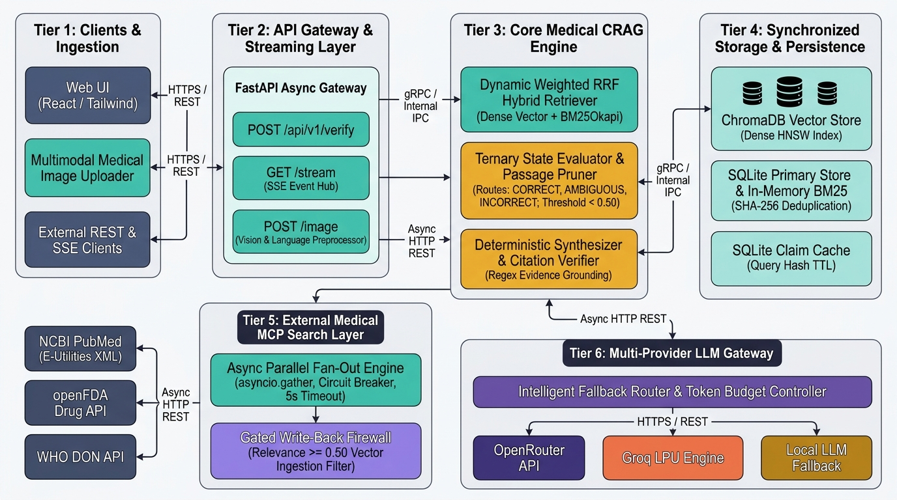
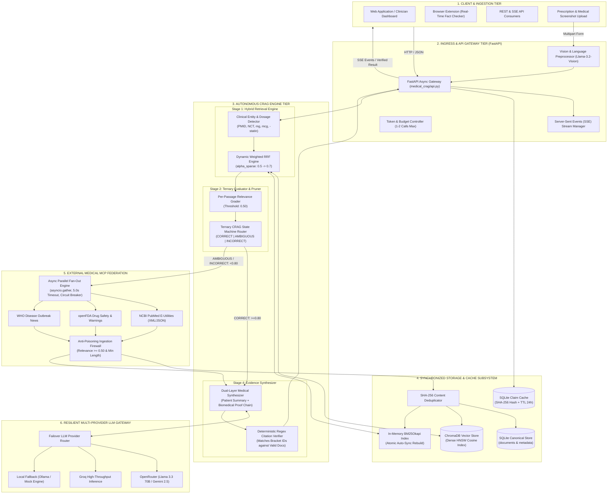

# Medical Corrective RAG (CRAG) Architecture Specification

**Version:** 2.0.0 (Production Specification)  
**Status:** Approved & Implemented  
**Classification:** Biomedical Decision Support & Health Claim Fact-Checking  

---

## 1. Executive Problem Statement & Motivation

Biomedical misinformation propagates rapidly, carrying severe public health risks. Standard Retrieval-Augmented Generation (RAG) suffers from critical limitations when deployed in healthcare:
1. **Corpus Boundary Vulnerability**: Static local vector stores lack recently published clinical trials, emerging disease outbreaks, or updated FDA boxed warnings.
2. **Hallucination Under Ambiguity**: Naive RAG forces generation regardless of retrieval quality, leading LLMs to confabulate scientific justifications.
3. **GraphRAG & Multi-Agent Complexity Trap**: Biomedical Knowledge Graphs (e.g. Neo4j/UMLS) introduce fragile schemas, non-deterministic graph traversals, and high latency (>30s), violating production SLA budgets.

**Medical Corrective RAG (CRAG)** implements an autonomous, high-speed, self-correcting 4-stage architecture designed for strict biomedical rigor, offline resilience, and guaranteed citation verification under a strict 1–2 LLM call budget.

---

## 2. System Design Architecture & Component Inventory

### 2.1 Multi-Tier System Design Architecture

---

## 3. Core Architectural Pillars

### 3.1 Synchronized Storage & SQLite Cache (`medical_crag/storage.py`)
To prevent split-brain discrepancies between vector storage (ChromaDB) and lexical search (BM25):
- **SQLite Document Store (`documents`)**: Persists canonical document metadata, content, source URL, and SHA-256 content hashes.
- **SQLite Claim Cache (`claim_cache`)**: Caches claim verifications with configurable TTL (default: 24h) to eliminate redundant LLM invocations for identical queries.
- **Immediate Index Synchronization**: Any call to `upsert_documents()` writes atomically to SQLite, upserts to ChromaDB, and triggers an incremental rebuild of the in-memory BM25 index.

### 3.2 Dynamic Weighted Reciprocal Rank Fusion (`medical_crag/retriever.py`)
Standard RRF uniformly merges ranks:
$$\text{RRF}(d) = \sum_{m} \frac{1}{k + \text{rank}_m(d)}$$
Medical CRAG upgrades this to **Dynamic Weighted RRF**:
$$\text{Score}(d) = \frac{\alpha_{\text{dense}}}{k + \text{rank}_{\text{dense}}(d)} + \frac{\alpha_{\text{sparse}}}{k + \text{rank}_{\text{sparse}}(d)} \quad (k = 60)$$
- **Lexical Boost Heuristic**: If the query contains exact clinical tokens (dosages like `mg`, `mcg`, clinical identifiers `PMID`, `NCT`, regulatory bodies `FDA`, or specific pharmacological suffixes `-statin`, `-mab`, `-nib`), the engine dynamically shifts $\alpha_{\text{sparse}}$ from $0.5$ to $0.7$ and $\alpha_{\text{dense}}$ from $0.5$ to $0.3$, ensuring exact biomedical identifiers are never submerged by semantic embeddings.

### 3.3 Ternary CRAG State Machine & Passage Grading (`medical_crag/evaluator.py`)
Instead of a naive binary pass/fail, the evaluator implements a 3-way decision tree:
- **Per-Passage Grading**: Every retrieved candidate document is assigned a relevance score $s \in [0.0, 1.0]$.
- **Pruning**: Any passage with $s < 0.50$ is discarded.
- **State Transitions**:
  1. `CORRECT`: $\max(s) \ge 0.80$ and $\ge 2$ passages survive pruning. Pipeline proceeds directly to synthesis.
  2. `AMBIGUOUS`: $0.50 \le \max(s) < 0.80$. Surviving local passages are retained, and targeted MCP search is triggered to supplement evidence.
  3. `INCORRECT`: $\max(s) < 0.50$. All local passages are discarded to prevent evidence contamination; external MCP search is executed.
- **Target MCP Routing**: Multi-target selection (`List[Literal["pubmed", "fda", "who"]]`) routes clinical research to PubMed, drug safety/interactions to openFDA, and global epidemic alerts to WHO.

### 3.4 Parallel Async MCP Fan-Out & Gated Write-Back (`medical_crag/mcp_tools.py`)
- **Async Concurrency**: External MCP searches execute in parallel via `asyncio.gather(..., return_exceptions=True)`.
- **Fault-Tolerant Deadlines**: Each tool runs with a strict 5.0s timeout and exponential backoff. If WHO or NCBI experiences latency or downtime, surviving results are collected without stalling.
- **Anti-Poisoning Ingestion Gate**: Raw search results are not blindly written to storage. Only documents passing length ($\ge 50$ chars) and keyword overlap ($\ge 0.70$) thresholds are ingested into ChromaDB and SQLite.

### 3.5 Deterministic Citation Verifier (`medical_crag/synthesizer.py`)
- Post-processing validator scans synthesized text with regex `r"\[([A-Za-z0-9_:-]+)\]"` and integer citation brackets `\[(\d+)\]`.
- Validates that every reference resolves to an item in `valid_doc_ids` (the union of pruned local passages and gated MCP results).
- Unverified/hallucinated citations are stripped or flagged, and the result is tagged with:
  - `citation_precision`: $\frac{|\text{verified}|}{|\text{total cited}|}$ (defaulting to 1.0 if no citations were generated).
  - `verified_citations`: Explicit list of validated identifiers.

---

## 4. Production API Specification (`medical_crag/api.py`)

- `POST /api/v1/verify`: JSON verification endpoint.
- `GET /api/v1/verify/stream`: Real-time Server-Sent Events (SSE) streaming pipeline stage changes (`retrieve` → `evaluate` → `mcp_correct` → `synthesize` → `complete`).
- `POST /api/v1/verify/image`: Multipart image upload endpoint extracting claims via Llama 3.2 Vision / Gemini Vision with language auto-detection.
